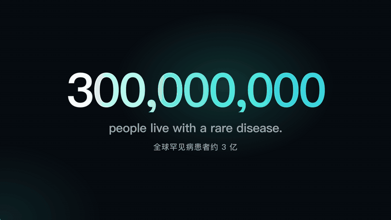

<div align="center">

# 🦓 zebra-mod

**基于 Claude Code 的罕见病研究工作站**

覆盖表型驱动的鉴别诊断、ACMG 变异分级、序列到功能预测与基因型到治疗检索，所有结论均附可供核查的来源。

[](LICENSE)
[](CHANGELOG.md)
[](https://claude.com/claude-code)
[](zebra/)

[English](README.md) · **中文**

</div>

> *"听到马蹄声，应先想到马，而非斑马。"* 医学教育强调优先考虑常见病，而罕见病患者常以"斑马"自称，因其诊断往往不在常规思路之内。zebra-mod 正是为在常规思路之外寻找答案而设计，并为每一步推断提供证据。

zebra-mod 是 [Claude Code](https://claude.com/claude-code) 的扩展模块（mod），服务对象包括**尚未明确诊断的患者及其家庭、临床医生与科研人员**。该模块为 Claude 提供 22 个工具，用于实时查询公共数据库（HPO、Monarch、Orphanet、ClinVar、gnomAD、Ensembl VEP、ClinGen、PanelApp、Open Targets、ClinicalTrials.gov、Europe PMC 等），并提供附带证据台账的病例工作区，以及诊断、变异解读、治疗检索与报告撰写的标准流程。用户以中文或英文正常提问即可，Claude 将根据问题自动调用相应工具。

<p align="center">
  <a href="docs/media/zebra-mod-promo.mp4">
    
  </a>
  <br><sub><a href="docs/media/zebra-mod-promo.mp4">▶ 观看高清版（MP4，30 秒）</a></sub>
</p>

## 主要能力

- **基于病历的鉴别诊断。** 将门诊记录、检验单与影像照片整理为经核验的 HPO 表型；三种相互独立的排序方法（离线、Monarch、PubCaseFinder）并列呈现，作为 Claude 临床推理的补充，而非替代。
- **变异解读，ACMG 分值由代码计算。** VEP、gnomAD、ClinVar、ClinGen、SpliceAI、AlphaMissense、REVEL 与 MaveDB 提供证据；证据条目由使用者判定，分值由 zebra 计算（Tavtigian 2020 积分制与 2015 组合规则并列给出）。
- **覆盖单核苷酸变异以外的结果类型。** 拷贝数变异与染色体芯片结果对照 ClinGen 剂量敏感性评估；外显子缺失给出读码框分析；支持 SMN1/SMN2 拷贝数解读；重复扩增（D4Z4、DMPK、FMR1、HTT 等）依据既定规则换算。
- **内置序列到功能模型。** SpliceAI、Pangolin、GPN-MSA、Evo 2 与 AlphaGenome 按各自维度分别报告，并注明结论上限；多维证据依一致性综合判断，不作数值平均。
- **基因型到治疗的检索与可及性评估。** 依据致病机制检索已上市及在研药物；FDA/EMA 状态取自监管机构记录；涵盖国内获批及医保目录收录情况、设有中国研究中心的在招临床试验，以及个体化治疗路径（反义寡核苷酸、碱基编辑）。
- **面向医生与家属的报告。** 生成临床医生摘要与通俗版家属资料，经独立子代理审查后，导出为符合中文排版规范的 HTML、Word 与 PDF 文件。
- **内置隐私保护。** 病例文件仅保存于本机；隐私闸门阻止已登记的姓名、出生日期及病历号出现在任何对外调用中。

## 快速开始

**1. 安装。** 在 Claude Code 中输入：

```text
安装 https://github.com/zwbao/zebra-mod
```

Claude 将依据 [INSTALL.md](INSTALL.md) 完成后续步骤：检查 Claude Code（≥ 2.1.289）与 Python（≥ 3.9）版本、安装插件、下载 HPO 数据（约 80 MB）并执行环境自检。亦可在终端中运行：

```bash
curl -fsSL https://raw.githubusercontent.com/zwbao/zebra-mod/main/install.sh | sh
```

**2. 运行演示病例。** 新建会话后输入 `/zebra demo`，系统将载入一个合成病例（含门诊记录与基因检测报告各一份），并预先填入首个问题；确认发送后，即可完整查看病历读取、鉴别诊断与变异解读的过程。

**3. 分析实际病例。** 无需掌握任何命令，直接以自然语言提问即可，例如：

```text
我女儿6个月开始发热抽搐，基因报告说 SCN1A NM_001165963.4:c.2134C>T，
这是什么意思？下次见神经科医生该问什么？
```

输入 `/zebra` 可查看全部功能；`/zebra new <文件夹>` 用于为单个患者建立病例，集中管理相关资料。

## 使用示例

| 用户类型 | 提问示例 |
|---|---|
| **患者或家属** | "跑了好几家医院都没查出来，这是孩子的检查单，可能是什么病？" · "VUS 对我儿子意味着什么？" · "国内有没有 FSHD 的临床试验？" · "帮我列一页下次复诊要问的问题。" |
| **临床医生** | "按这些 HPO 术语给出鉴别诊断排序，以及每个候选该用什么检测确认。" · "结合这个家系的共分离，对该变异做 ACMG 解读。" · "DM1 合并传导阻滞患者的管理与随访方案。" · "血管型 EDS 患者能做导管血管造影吗？" |
| **研究者** | "结合表型重新分析这份三人家系 VCF。" · "对这个深部内含子变异跑 SpliceAI、Pangolin 和 AlphaGenome。" · "计算这些减数分裂的共分离似然比。" · "DMD 第 45–50 外显子缺失，跳读哪个外显子能恢复读码框？" |

各项功能的详细说明（按工具逐项列出）见 [docs/FEATURES.md](docs/FEATURES.md)。

## 工作原理

```
用户
└─► Claude Code
      ├─ 研究准则（系统提示）· 13 个技能 · 6 个子代理
      └─► zebra-mod 钩子
            ├─ 隐私闸门
            └─► 22 个工具（mcp__zebra-mod__*）
                  └─► zebra 引擎（Python，仅标准库）
                        ├─► 公共数据库与模型：HPO · Monarch · ClinVar · gnomAD · VEP · ClinGen …
                        └─► 本机病例文件夹：case.json · evidence/ledger.jsonl（E1、E2…）· reports/
```

- **计算由代码完成，解读由模型完成。** 排序、ACMG 分值、重复单位数与统计量均由 `zebra` 引擎计算，模型不编写、不修改任何数值。若决定性证据超出排序方法的覆盖范围，模型将明确说明理由并调整结论。
- **来源全程留档。** 每次工具调用的结果连同数据库、记录编号与检索时间写入病例证据台账，报告据此引用来源。
- **模型知识须明确标注。** 本次检索所得与模型既有知识分别标示，便于读者区分已核实与待核实的内容。
- **只增强、不限制。** 模块不设置任何前置步骤：优先回答问题，病例整理等工作随后或同步进行。

该引擎同时提供命令行接口，可在终端、Jupyter 笔记本或其他智能体中直接调用：

```bash
zebra phenotype rank --present HP:0002373 HP:0001263 --sources local,monarch,pubcasefinder
zebra acmg suggest NM_001165963.4:c.2134C>T --inheritance AD
zebra acmg classify PVS1 PS2 PM2_Supporting
zebra s2f predict 12-25245350-C-T --models spliceai,pangolin,gpn_msa
zebra vcf triage trio.vcf.gz --proband P --mother M --father F --sex female --hpo-genes
zebra stats maxaf --prevalence 0.0000625 --allelic 0.05 --penetrance 0.9
```

## 性能评估

以下结果均经实测，方法与置信区间详见 [docs/BENCHMARK.md](docs/BENCHMARK.md)：

- **表型排序**（GA4GH phenopacket-store，10,374 例已发表病例，按疾病划分开发集与留出集）。在其来源文献未参与构建 HPO 注释的留出病例上（即对新患者最具代表性的检验），正确疾病进入离线排序前 10 位的比例为 **28%**，致病基因为 **40%**。排序结果仅为待验证的假设，因此与 Claude 的鉴别诊断并列呈现。
- **启用与未启用模块的对照评测**（6 个留出端到端病例，由未接触模块说明的独立代理编写，每组各运行 8 次，依据临床指南逐项评分）。合并后两组差异不显著（差值 −0.02，95% 置信区间 −0.16 至 +0.12）：在长篇病历中识别急症、结合共分离解读 VUS 两类病例中，启用模块表现更优；另有两例表现较差。"启用模块不会降低回答质量"尚未得到证实，基准文档对此如实记录。
- [`evals/`](evals/) 中有 **19 个端到端评测**，通过 `claude plugin eval` 运行，涵盖中文家长提交的病历、应按肿瘤学而非罕见病框架解读的体细胞肿瘤报告等场景。

## 隐私与安全

- **本地存储：** 病例文件、病历及证据台账仅写入本机。
- **不外发个人标识：** zebra 不发送姓名、出生日期与病历号，数据库查询仅包含生物学信息（HPO 编号、基因、变异）。外发调用若含已登记标识，或身份证号、手机号、电子邮箱格式的内容，隐私闸门将予以拒绝；病例文件或原始基因组文件外传前须经确认。
- **隐私闸门的局限：** 交由 Claude 阅读的病历均会作为对话内容发送至模型服务商，与在 Claude Code 中打开其他文件相同。如有顾虑，请事先脱敏。
- **急症优先：** 对需当日就医的症状，系统会在任何分析之前首先提示。
- **研究用途：** zebra-mod 生成的分析为供医生审阅的草稿，不属于医疗器械，不独立作出诊断或开具处方，亦不能替代临床医生或遗传咨询师。

## 配置

可在 `/config` → zebra-mod 中设置，或于 settings 的 `pluginConfigs` 中配置：

| 选项 | 默认 | 作用 |
|---|---|---|
| `doctrine` | `auto` | 打开病例时启用完整研究准则，否则仅对罕见病相关问题启用简版准则；可选 `always`、`case`、`off` |
| `privacyGate` | 开 | 上文所述的外发调用检查 |
| `interface` | `full` | 显示工具行、状态提示与斑马动画；`quiet` 不显示动画；`off` 仅使用 Claude Code 原生界面 |
| `python` | `python3` | 引擎使用的 Python 解释器 |

可选序列模型（`/zebra doctor` 将逐项检查）：

| 模型 | 需要 |
|---|---|
| SpliceAI、Pangolin、GPN-MSA | 无需额外配置 |
| Evo 2 | `NVCF_RUN_KEY`（NVIDIA 托管服务） |
| AlphaGenome | `ALPHAGENOME_API_KEY` 与 `pip install alphagenome`（或设置 `ZEBRA_ALPHAGENOME_PYTHON`）；仅限非商业用途，不得用于临床决策 |

## 文档

| | |
|---|---|
| [docs/FEATURES.md](docs/FEATURES.md) | 全部能力、工具、技能与子代理 |
| [docs/BENCHMARK.md](docs/BENCHMARK.md) | 排序基准与启用/未启用模块的对照评测 |
| [docs/DATA-SOURCES.md](docs/DATA-SOURCES.md) | 各数据库与模型的使用条款和许可 |
| [docs/PRD.md](docs/PRD.md) · [docs/ROADMAP.md](docs/ROADMAP.md) | 设计与后续计划 |
| [INSTALL.md](INSTALL.md) · [CHANGELOG.md](CHANGELOG.md) | 安装步骤与版本说明 |

## 开发

```
hooks/        模块本体：工具、准则、隐私闸门、病例面板、/zebra     （TypeScript）
skills/       13 个流程，由 zebra-start 分派
agents/       6 个子代理（整理、检索、证据审查）
zebra/        引擎：数据源、ACMG、统计、VCF、S2F、报告导出          （Python，仅标准库）
evals/        `claude plugin eval` 端到端评测
tests/        pytest（默认离线；设置 ZEBRA_NETWORK_TESTS=1 运行联网测试）
```

```bash
python3 -m pytest -q            # 引擎
claude plugin test .            # mod 钩子
claude plugin validate .        # 清单、技能、子代理
claude --plugin-dir .           # 以当前代码启动单次会话
```

欢迎提交 issue 与 pull request。修改准则或技能时，请一并提供启用与未启用模块的对照评测（`claude plugin eval --ablation with-without`）；`evals/heldout-*` 中的留出评分标准不得为迎合结果而修改。

## 数据来源与许可

zebra-mod 实时查询公共资源并记录每项结果的出处，各资源适用其自身条款（见 [docs/DATA-SOURCES.md](docs/DATA-SOURCES.md)）。特别注意：AlphaGenome 输出仅限非商业用途且不得用于临床决策；SpliceAI 权重为 CC BY-NC；不转载 OMIM 内容。

## 引用

```bibtex
@software{zebra_mod,
  author  = {zwbao},
  title   = {zebra-mod: a rare-disease research workstation for Claude Code},
  year    = {2026},
  version = {0.3.9},
  url     = {https://github.com/zwbao/zebra-mod}
}
```

## 致谢

本项目建立在 HPO、Monarch、Orphanet、ClinGen、ClinVar、gnomAD、Ensembl、PanelApp、Open Targets、Europe PMC、PubTator、LitVar 与 PubCaseFinder 团队的工作之上，也感谢 SpliceAI、Pangolin、GPN-MSA、Evo 2 与 AlphaGenome 的作者。界面中的斑马动画取材自埃德沃德·迈布里奇 1878 年的连续摄影作品《运动中的马》（公有领域）。

MIT 许可 © 2026 zwbao。
